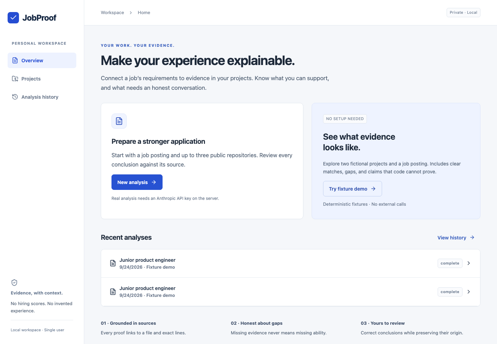

# JobProof

A local evidence workspace for an honest job application. Paste a job posting, select up to three public GitHub projects, review extracted requirements, and inspect the sources behind each conclusion. No ATS score, hiring probability, or certification of competence.

## Implemented

- FastAPI, Pydantic, SQLAlchemy, Alembic and SQLite, with durable tasks and bounded in-process concurrency.
- React + strict TypeScript + Vite + Tailwind, TanStack Query polling, accessible native forms and modal source viewer.
- Public GitHub API imports pinned to a commit, exclusion inventory, limits, secret-pattern redaction and immutable source excerpts. Imported repositories are **never executed**.
- Structured Anthropic SDK provider, separate deterministic demo provider, BM25 retrieval with explicit aliases, server-validated citations and conservative downgrades.
- Editable/selectable requirements with verifiable posting offsets and optimistic version checking; manual requirements have no fabricated posting citation.
- Four assessment states, report filters, original model output, append-only human review history, added/removed evidence, Markdown/JSON export and analysis history.
- Reproducible fixtures and 32 labeled evaluation cases, with development, validation and final holdout partitions.

## Run locally

Prerequisites: Python **3.12+** (tested on 3.14.7), Node **22.12+**, and pnpm. Docker is not required. Dependencies require internet for installation; the demo requires none once installed.

From this `jobproof` directory:

```sh
python3 -m venv .venv
.venv/bin/python -m pip install -r backend/requirements.lock
cp .env.example .env
cd backend
../.venv/bin/alembic upgrade head
cd ../frontend
pnpm install --frozen-lockfile
cd ..
```

Start in two terminals:

```sh
./scripts/start-backend.sh
```

```sh
./scripts/start-frontend.sh
```

Open **http://127.0.0.1:5173**. API documentation: **http://127.0.0.1:8000/docs**.

The Python lock pins all runtime and test dependencies. `pnpm-lock.yaml` pins frontend dependencies. `pnpm-workspace.yaml` explicitly allows the esbuild and Tailwind native setup scripts; this is for JobProof's own dependencies, never imported projects. Run the backend from `backend/` so `../.env` and the SQLite path resolve consistently. Use one backend process, not multiple Uvicorn workers.

## Demo walkthrough

1. Click **Try fixture demo**. No GitHub account or AI key is involved.
2. Review eight requirements; edit priorities, remove incorrect items or add a manual requirement. Save edits independently, or save and analyze together.
3. Keep the two fixture project snapshots selected and click **Analyze evidence**.
4. Open an evidence row to see the exact file lines. Fixture evidence has no invented GitHub URL.
5. Expand **Review conclusion**, give a reason, optionally add or remove a source, and save. The original model result remains available.
6. Export Markdown or JSON. Previous analyses are available in history.

The fixtures deliberately contain an unused PostgreSQL dependency, an unsupported encryption claim, an authorization implementation with a negative test, a Dockerfile without deployment evidence, and a malicious README instruction. They are source examples, not runnable production applications. Fixture code is stored canonically in `backend/app/demo.py` and mirrored under `fixtures/` for reading.

To load fixtures from a terminal while the server is running:

```sh
./scripts/load-demo.sh
```

Demo assessment rules only cover their known fixture requirements. Editing them does not turn the demo into an AI model; unfamiliar wording gets an explicit conservative result.

## Real mode

Set `ANTHROPIC_API_KEY` (e.g. `sk-ant-...`) or `GEMINI_API_KEY` (e.g. `AIza...`) in the **server's** `.env`, then restart the backend. `LLM_MODEL` defaults to `claude-sonnet-4-6` for Anthropic or `gemini-2.5-flash` for Gemini and is configurable. You can also explicitly set `LLM_PROVIDER=gemini` or `LLM_PROVIDER=anthropic`. The Anthropic implementation uses official `anthropic==1.8.0` with `client.messages.parse(..., output_format=PydanticModel)`; the Google Gemini implementation uses REST structured outputs (`response_schema` and `application/json` via `httpx`). Schema parsing is followed by deterministic citation validation. No key is returned to the browser. A missing key is an error, never a demo fallback.

In **Projects**, add a public URL such as `https://github.com/owner/repository`, optionally a branch/commit, and import it. The server resolves a SHA and fetches only tree/blob API endpoints on GitHub. Private repositories are rejected, even when `GITHUB_TOKEN` is configured. A token is optional and only improves API limits.

Create a posting with **New analysis**, save, extract requirements, review them, select snapshots and analyze. Real extraction sends the redacted posting to the AI provider; assessment sends only bounded, retrieved excerpts. Interview preparation receives validated assessment summaries. Provider calls may incur charges according to your account; the app displays tokens and calls, not invented dollar costs.

## Checks actually executed

- **61 pytest checks passed**: URL restrictions, exclusions, partial import, commit references, chunk lines, invalid/unsent/out-of-scope citations, safe downgrade, redaction, requirement versions, original-preserving review, exports, duplicate requests including concurrent submits, malformed provider output, restart recovery, cancellation, injection fixtures, and official Anthropic/Gemini provider contracts.
- **1 Vitest check passed** for four-state summary counts.
- **3 Playwright checks passed**: complete demo → evidence → review → Markdown download, desktop/mobile rendering with no horizontal overflow, inert rendering of hostile posting HTML, and recovery of a completed extraction after reload.
- Official Anthropic SDK contract tests exercise structured JSON, token accounting, secret redaction with stable posting offsets, malformed output, refusal, truncation, authentication failure and the call budget. No external requests or charges occur in these tests.
- Strict TypeScript compilation and Vite production build passed. Ruff lint/format passed.
- A **live public GitHub import passed** for `octocat/Hello-World`: commit `7fd1a60b01f91b314f59955a4e4d4e80d8edf11d`, one README, 13 bytes. Details: `docs/github-smoke.json`.
- Evaluation was run on all 32 cases with the deterministic provider. See `docs/evaluation.md`; this does **not** measure Anthropic quality.

**Not executed:** paid Anthropic calls, real multilingual extraction, real-model assessment quality, broad browser/OS compatibility, or an accessibility audit. Configure your own server key to run the real-provider benchmark.

## Test commands

```sh
cd backend
../.venv/bin/pytest -q
../.venv/bin/ruff check app tests migrations
../.venv/bin/ruff format --check app tests migrations
../.venv/bin/python ../evaluation/run.py --provider demo --split all
# Requires ANTHROPIC_API_KEY; makes external provider calls:
../.venv/bin/python ../evaluation/run.py --provider real --split holdout
cd ../frontend
pnpm test
pnpm build
pnpm exec playwright install chromium
# Backend and frontend must already be running locally:
pnpm e2e
```

Browser tests create local demo reports and a hostile-text test posting in the development database; use a disposable `DATABASE_URL` for clean runs. The test suite uses a separate temporary SQLite database for every backend test.

## Limits and honest caveats

- Up to 3 projects and 15 selected requirements per analysis. Default per-project caps: 150 text files, 100 KB/file, 5 MB total. Up to 5 chunks/requirement and 60,000 excerpt characters per analysis. These are local resource/context bounds, not completeness guarantees.
- Partial imports, excluded requirements and context omissions are visible. Missing evidence never proves missing ability or absent functionality.
- Citations establish exact text presence in the **normalized, redacted snapshot**, not semantic correctness. No imported tests are run; dates, contributors and README language do not establish employment, authorship or fluency.
- Secret filtering is imperfect. Review a repository before sending excerpts to a provider.
- Jobs survive page reload; interrupted work is marked on backend restart. Explicit retry creates a fresh operation. Cancellation cannot recall an external request already sent. No exactly-once provider-call claim.
- Recommendations reflect the original analysis; revisit them after human review. Reviews are visible in exports and do not overwrite original model output.
- Native browser validation is used instead of adding React Hook Form/Zod to small forms. App copy begins in a shared copy object; full translation catalogs are future work.
- SQLite records use versioned JSON aggregates, with separately addressable snapshots/files/chunks/tasks/assessments. This simplifies the single-user MVP; database-level relational foreign keys and public multi-user operation are not implemented.
- The real provider is implemented and its official SDK request/response contract tested with an in-memory HTTP transport, but the end-to-end real LLM path remains unverified without credentials.

## Architecture and evidence

```text
GitHub → commit snapshot → filtered/redacted files → line chunks
Job text → structured extraction → user revision → requirement version
Selected snapshots + requirements → BM25 top-k → provider assessment
→ server citation validation → durable report → human reviews → exports
```

See [architecture](docs/architecture.md), [security](docs/security.md), [evaluation](docs/evaluation.md), and [product decisions](docs/product-decisions.md).

Real browser captures:



[Desktop report capture](docs/report-desktop.png)

[Mobile report capture](docs/report-mobile.png)
